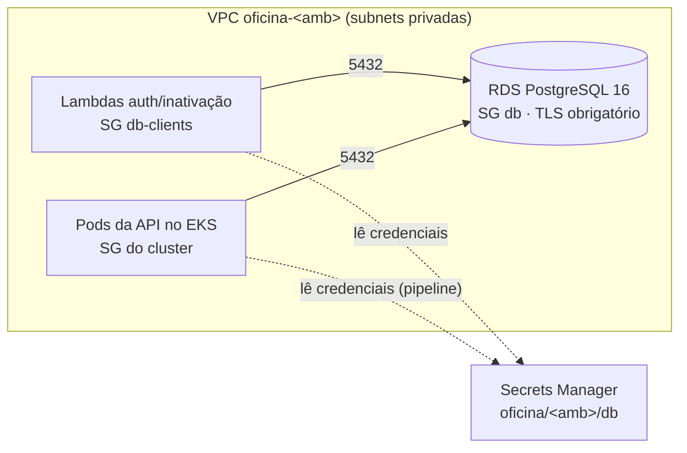
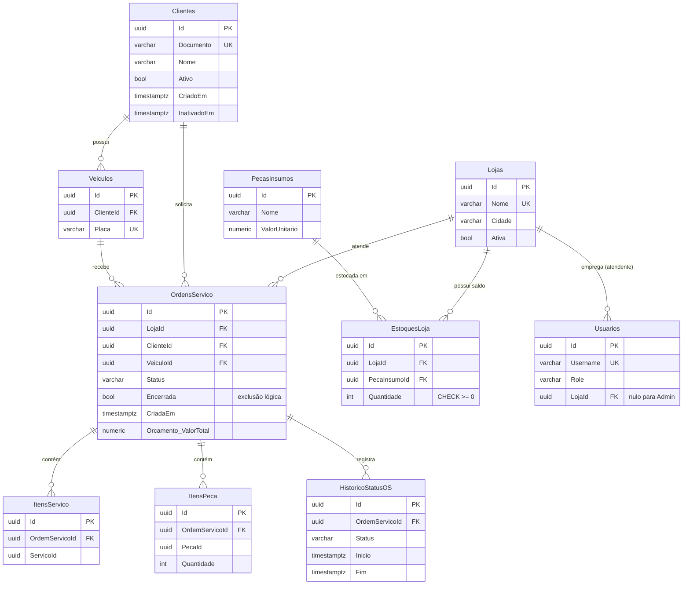

# oficina-infra-db

Infraestrutura do **banco de dados gerenciado** da oficina: Amazon RDS for PostgreSQL 16 provisionado com Terraform, rede privada, segredo de credenciais e pipeline de deploy.

Repositório 3 de 4 do Tech Challenge da Fase 3 (SOAT):

| Repositório | Conteúdo |
| --- | --- |
| oficina-lambda-auth | Lambdas de autenticação (CPF e funcionário) e job de inativação de clientes |
| oficina-infra-k8s | VPC, cluster EKS, API Gateway, segredo do JWT, tópico SNS |
| **oficina-infra-db** (este) | RDS PostgreSQL, security groups e segredo do banco |
| [tech-challenge-oficina-mecanica](https://github.com/menta2010/tech-challenge-oficina-mecanica) | API de ordens de serviço rodando no Kubernetes |

**Ordem de deploy:** infra-k8s → **infra-db** → lambda-auth → app. Este repositório usa a VPC e o cluster EKS já existentes.

## Links

| Item | Link |
| --- | --- |
| API publicada (prod) | https://7d2ypan7l9.execute-api.us-east-1.amazonaws.com |
| Swagger | https://7d2ypan7l9.execute-api.us-east-1.amazonaws.com/swagger |
| Collection Postman | [oficina-fase3.postman_collection.json](https://github.com/menta2010/tech-challenge-oficina-mecanica/blob/master/docs/postman/oficina-fase3.postman_collection.json) |

O ambiente roda no AWS Academy: a URL só responde enquanto o laboratório está ligado.

## O que é provisionado

| Recurso | Detalhe |
| --- | --- |
| `aws_db_instance` | PostgreSQL 16, `db.t4g.micro`, 20 GB gp3 com autoscaling até 50 GB, criptografado, **sem acesso público** |
| Subnet group | Subnets privadas da VPC (tag `Tier=private`) |
| Security group `oficina-<amb>-db` | Porta 5432 liberada só para o SG `db-clients` e para o SG do cluster EKS |
| Security group `oficina-<amb>-db-clients` | Atribuído às Lambdas que precisam do banco |
| Parameter group | `rds.force_ssl = 1` (TLS obrigatório) e log de consultas acima de 500 ms |
| Secrets Manager `oficina/<amb>/db` | JSON `host`, `port`, `dbname`, `username`, `password` (senha gerada pelo Terraform) |

Logs do PostgreSQL (incluindo as consultas lentas) vão para o CloudWatch e de lá para o New Relic.



## Por que PostgreSQL

O núcleo do sistema é transacional e relacional: uma OS liga loja, cliente, veículo, serviços, peças, orçamento e estoque, e a baixa de peça precisa ser atômica com a mudança da OS.

- **Integridade:** chaves estrangeiras, `UNIQUE` (CPF, placa, loja + peça) e `CHECK` (estoque nunca negativo) garantem consistência no próprio banco, não só na aplicação.
- **Transações ACID:** usar uma peça baixa o estoque e atualiza a OS na mesma transação.
- **Consultas analíticas simples:** tempo médio por status e volume diário saem de `GROUP BY` sobre o histórico, sem outro banco.
- **Gerenciado no RDS:** backup automático, patches, Multi-AZ opcional, criptografia e métricas no CloudWatch, sem administrar servidor.
- **Continuidade:** a aplicação já usava PostgreSQL desde a Fase 1 (EF Core + Npgsql), sem custo de migração.

Alternativas descartadas: DynamoDB (o modelo tem muitas relações e consultas por vários critérios, que em NoSQL exigiriam duplicação de dados) e Aurora Serverless (mais caro para o volume atual; fica como evolução se o tráfego crescer). Detalhes na RFC-002 da documentação de arquitetura.

## Modelo relacional (Fase 3)



### O que mudou em relação à Fase 2

| Mudança | Motivo |
| --- | --- |
| Tabela `Lojas` e `LojaId` em OS e usuários | Expansão para múltiplas unidades; cada atendente opera só a própria loja |
| `EstoquesLoja` (loja × peça) no lugar de `PecasInsumos.QuantidadeEmEstoque` | O catálogo é único, mas o saldo físico é de cada loja. `UNIQUE (LojaId, PecaInsumoId)` e `CHECK (Quantidade >= 0)` |
| `Clientes.Ativo`, `CriadoEm`, `InativadoEm` | Status consultado pela autenticação por CPF e base da política de inativação (ADR-005) |
| `HistoricoStatusOS` | Um registro por período em cada status, base do dashboard "tempo médio por status" e trilha de auditoria |
| `OrdensServico.Encerrada` + índice `(Encerrada, LojaId, Status, CriadaEm)` | Exclusão lógica explícita e indexada para a listagem operacional (ajuste pedido na correção da Fase 2) |
| Chaves estrangeiras em `OrdensServico` (loja, cliente, veículo) e `Veiculos.ClienteId` | Antes eram colunas soltas; agora o banco impede referências órfãs |
| Schema versionado por **migrations** do EF Core | Substitui o `EnsureCreated`; o deploy da aplicação aplica as migrations pendentes |

### Índices e para que servem

| Índice | Consulta atendida |
| --- | --- |
| `Clientes (Documento)` único | Autenticação por CPF na Lambda (igualdade) |
| `Clientes (Ativo)` | Job de inativação |
| `OrdensServico (Encerrada, LojaId, Status, CriadaEm)` | Listagem operacional por loja, sem as encerradas |
| `OrdensServico (ClienteId)` | "Minhas OS" do cliente autenticado |
| `HistoricoStatusOS (OrdemServicoId, Inicio)` | Histórico da OS e tempo por status |
| `EstoquesLoja (LojaId, PecaInsumoId)` único | Baixa e reposição de estoque |

## Tecnologias

Terraform 1.13 · AWS provider 5 · Amazon RDS for PostgreSQL 16 · AWS Secrets Manager · GitHub Actions

## Executando

Pré-requisitos: AWS CLI autenticado, bucket S3 para o estado do Terraform e o repositório `oficina-infra-k8s` já aplicado no mesmo ambiente.

```bash
terraform init -backend-config="bucket=<bucket-do-estado>" -backend-config="key=oficina/infra-db/homolog.tfstate" -backend-config="region=us-east-1"
terraform plan -var="environment=homolog"
terraform apply -var="environment=homolog"
```

Para destruir o ambiente (evitar custo fora da demonstração):

```bash
terraform destroy -var="environment=homolog"
```

## CI/CD

| Evento | O que roda |
| --- | --- |
| Pull Request para `develop` ou `main` | `fmt`, `validate` e `plan` do ambiente de destino |
| Merge em `develop` | `apply` em **homolog** e espera o RDS ficar disponível |
| Merge em `main` | `apply` em **prod** |

Configuração no GitHub (uma vez):

1. Environments `homolog` e `prod` com os secrets `AWS_ACCESS_KEY_ID`, `AWS_SECRET_ACCESS_KEY` e `AWS_SESSION_TOKEN` (este só no AWS Academy), e as variables `TF_STATE_BUCKET` e `AWS_REGION`. No environment `prod`, a variable `TF_EXTRA_ARGS` pode receber `-var=multi_az=true -var=deletion_protection=true`.
2. Proteção das branches `main` e `develop`: Pull Request obrigatório, check `Terraform validate` obrigatório e push direto bloqueado.
3. Colaborador `soat-architecture` com acesso de leitura.
